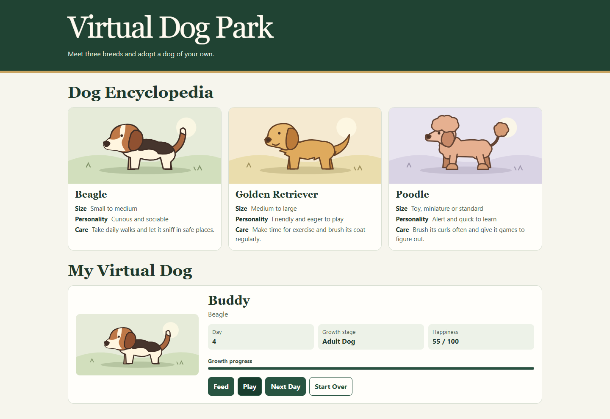

# Virtual Dog Park

Virtual Dog Park is a small dog encyclopedia and virtual pet website for AIE1101 Week 8 Lab 2. It uses HTML, CSS, and vanilla JavaScript.

## What you can do

- Read size, personality, and care notes for Beagle, Golden Retriever, and Poodle.
- Choose a breed and adopt one dog with a name of up to 20 characters.
- Feed your dog, play with it, and move forward one day at a time.
- Refresh the page to continue with the same dog, or use Start Over to clear it after confirming.

The three SVG files in `assets/` are original illustrations created for this project.

## Run the site

1. Open the `virtual-dog-park` folder in VS Code.
2. Install the **Live Server** extension by Ritwick Dey.
3. Right-click `index.html` in the Explorer and choose **Open with Live Server**.
4. Open the local HTTP address in your browser. Use the same browser and address when checking saved progress.

## Game rules

| Action or day | Result |
| --- | --- |
| Adopt | Day 1, Puppy, happiness 50 |
| Feed or Play | Add 10 happiness, up to 100 |
| Next Day | Add one day and subtract 5 happiness, down to 0 |
| Days 2 and 3 | Young Dog |
| Day 4 onward | Adult Dog |

The growth bar has three positions, and the stage is also shown in text.

## Saved progress

The app saves the dog's name, breed, day, and happiness under `virtualDogParkPetV1` in the browser's `localStorage`. It updates the save after adoption, Feed, Play, and Next Day. The save stays with that browser and local web address. GitHub stores the project files. Start Over removes the saved dog if you confirm.

## Manual test checklist

- [ ] All three cards show their SVG illustrations and care notes.
- [ ] An empty or spaces-only name is rejected. Outer spaces are trimmed, names are limited to 20 characters, and angle brackets display as text.
- [ ] Adopt Buddy as a Beagle and check Day 1, Puppy, and happiness 50.
- [ ] Feed and Play add 10 each, up to 100.
- [ ] Next Day subtracts 5, down to 0. Check Young Dog on Days 2 and 3 and Adult Dog on Day 4.
- [ ] Refresh after adoption, Play, Next Day, and Feed. Check that the latest values return each time.
- [ ] Cancel Start Over and check that the dog stays. Confirm Start Over, refresh, and check that the adoption form returns.
- [ ] At phone width, the cards stack and the form and pet buttons fit without sideways scrolling.

## Screenshot

